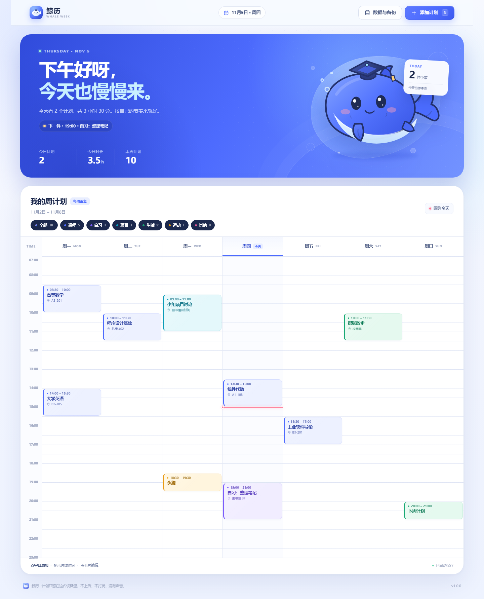
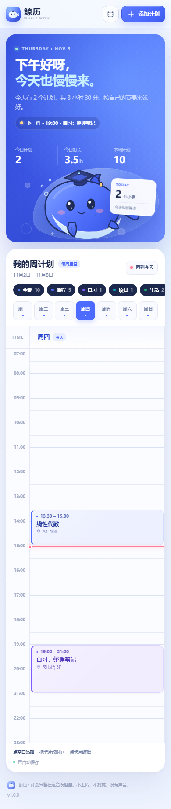

<div align="center">


# 鲸历 WhaleWeek

**把一周，游成喜欢的样子。**

DeepSeek 蓝 · 学士帽胖鲸鱼 · 大学课表式周计划<br>
本地保存 · 没有声音 · 没有外部请求

[**在线使用**](https://double-stars799.github.io/WhaleWeek/) · [功能](#功能) · [本地运行](#本地运行) · [数据说明](#数据说明)

</div>

---



## 这是什么

鲸历是一款**像大学课程表一样**的每周计划应用。

你可以把课程、自习、项目、运动和生活中的事情放进七天时间轴里，按实际时间排列；点空白格就能添加，拖一下就能改时间，所有数据只留在当前浏览器里。

它很安静：没有提示音、没有推送、没有账号、没有外部网络请求。

---

## 功能

| | 功能 | 说明 |
| --- | --- | --- |
| 🐳 | 大学课表式周视图 | 周一至周日，07:00–23:00 时间轴，精确到 15 分钟 |
| ➕ | 点空白即添加 | 点任意空白时间段，自动带入星期和开始时间 |
| ✋ | 拖动与拉伸 | 拖动卡片改星期 / 时间；拖卡片底部改结束时间，自动吸附到 15 分钟 |
| ✏️ | 随时编辑 | 点卡片修改标题、时间、地点、备注和分类 |
| 🎨 | 六种分类 | 课程 / 自习 / 项目 / 生活 / 运动 / 其他，颜色一眼区分 |
| 🔎 | 分类筛选 | 一键只看某一类，再点“全部”恢复 |
| 📱 | 手机日视图 | 小屏自动变为单日时间轴，顶部七日切换 |
| 💾 | 自动保存 | 每次修改立即写入浏览器 `localStorage`，刷新不丢 |
| 📦 | 备份与恢复 | 导出 / 导入 JSON，换设备或清缓存前留一份 |
| 🖨️ | 打印课表 | 自带打印样式，建议横向打印 |
| 📲 | 安装成应用 | PWA 可安装到桌面 / 手机，支持离线打开 |
| 🔇 | 真的没有声音 | 不包含任何音频文件，也不调用语音 / 通知 |
| 🧩 | 零运行时依赖 | 原生 HTML / CSS / JS，无构建步骤，改完即生效 |

### 手机上



---

## 本地运行

### 方式一：双击（最简单）

双击 **`启动鲸历.bat`**。

- 电脑上有 Node.js：自动启动本地预览，并打开浏览器。
- 没有 Node.js：直接用浏览器打开 `index.html`，功能同样可用。

> 直接打开 `index.html` 也能添加、编辑、保存计划；“安装到桌面 / 离线缓存”需要以 `http://` 或 `https://` 打开。

### 方式二：Node.js

```bash
npm start
# 打开 http://127.0.0.1:4173/
```

想自动打开浏览器：

```bash
npm run start:open
```

### 方式三：任意静态服务器

```bash
python -m http.server 4173
```

然后访问 <http://127.0.0.1:4173/>。

---

## 怎么用

1. **添加**：点顶部“添加计划”，或直接点课表里的空白时间段。
2. **调整**：桌面端按住卡片拖动，拖到其他天也行；拖卡片底边可以改时长。
3. **编辑 / 删除**：点卡片打开详情。删除后可以在底部提示条里点“撤销”。
4. **筛选**：点分类标签只看某一类；点“全部”恢复。
5. **备份**：右上角“数据与备份” → 导出备份。建议偶尔导出一份 JSON。
6. **安装**：用 Chrome / Edge 打开部署后的网址，点地址栏的安装图标，或“数据与备份”里的“安装到桌面”。

### 快捷键

| 按键 | 作用 |
| --- | --- |
| `N` | 新建计划 |
| `Enter` / `Space` | 聚焦卡片时打开编辑 |
| `Esc` | 关闭弹窗 |

---

## 数据说明

- 数据保存在浏览器的 `localStorage`，键名是 `whale-week:data:v1`。
- 没有账号、没有云同步、没有埋点，也不会向任何服务器发送计划内容。
- 清除浏览器网站数据、换浏览器或换设备，数据都不会自动跟过去。请用“导出备份”迁移。
- 备份就是一个可读的 JSON 文件，结构如下：

```json
{
  "app": "whale-week",
  "version": 1,
  "plans": [
    {
      "id": "a-unique-id",
      "title": "高等数学",
      "day": 1,
      "start": "08:30",
      "end": "10:00",
      "location": "A3-201",
      "note": "带习题册",
      "category": "course"
    }
  ]
}
```

`day` 使用 `1–7` 表示周一到周日；分类可用 `course` `study` `project` `life` `sport` `other`。

---

## 自定义

这是一个无构建的静态项目，修改后刷新页面即可看到效果。

| 想改什么 | 去哪改 |
| --- | --- |
| 品牌蓝、背景色、圆角、阴影 | `assets/css/styles.css` 顶部 `:root` |
| 时间范围、默认时长、吸附间隔 | `assets/js/app.js` 顶部常量（`START_MIN` / `END_MIN` / `SNAP` / `MIN_DURATION`） |
| 分类名称与颜色 | `assets/js/app.js` 的 `CATEGORIES`，以及 CSS 里的 `.cat-*` 色板 |
| 鲸鱼形象 | `assets/img/whale.svg`（主视觉）与 `assets/img/icon.svg`（图标） |
| 页面文案 | `index.html` |
| 移动端断点 | `assets/css/styles.css` 的 `@media` 部分 |

时间轴每小时高度由 JS 的 `HOUR_HEIGHT` 控制（当前 56px）；如果改了它，请同时同步 CSS 里的 `--hour-height`，或直接保留默认值。

### 修改离线缓存版本

改过 `index.html`、CSS、JS 或图片后，把 `sw.js` 里的：

```js
const CACHE_VERSION = 'whale-week-v1.0.0';
```

改成新版本号（例如 `v1.0.1`），已安装的用户才会拿到新资源。

---

## 项目结构

```text
WhaleWeek/
├─ index.html                 页面结构
├─ manifest.webmanifest       PWA 配置
├─ sw.js                      离线缓存
├─ assets/
│  ├─ css/styles.css          全部样式（含响应式与打印）
│  ├─ js/app.js               数据、渲染、拖拽、导入导出
│  └─ img/                    鲸鱼插画、图标、分享封面
├─ scripts/serve.mjs          零依赖本地预览服务器
├─ 启动鲸历.bat               Windows 一键启动
├─ docs/                      截图
└─ .nojekyll                   GitHub Pages 跳过 Jekyll
```

---

## 部署到 GitHub Pages

项目是纯静态的，不需要构建。仓库公开后：

1. 打开仓库 **Settings → Pages**。
2. **Build and deployment → Source** 选择 **Deploy from a branch**。
3. 分支选择 `main`，目录选择 `/ (root)`，点击 **Save**。
4. 一两分钟后，页面会发布到：

```text
https://<你的用户名>.github.io/WhaleWeek/
```

之后每次推送到 `main`，GitHub Pages 都会自动更新。项目根目录的 `.nojekyll` 会让 Pages 直接按静态文件发布。

> 在线版：<https://double-stars799.github.io/WhaleWeek/>

---

## 浏览器支持

- Chrome / Edge / Firefox / Safari 的较新版本。
- 桌面端、平板、手机都有对应布局。
- “安装到桌面”和完整离线能力在 Chromium 内核浏览器 + HTTPS 下体验最好。
- 无构建、无 npm 依赖，直接用浏览器打开即可运行。

---

## 设计说明

视觉围绕 DeepSeek 标志性的深海蓝展开：大面积的蓝、浅蓝气泡、白色留白和一只戴学士帽的胖鲸鱼。没有使用任何外部图片、字体或图标库，所有插画都是项目内的 SVG，离线也不会掉图。

声音不在设计里。没有提示音，也不会请求通知权限。

---

## License

[MIT](LICENSE)
